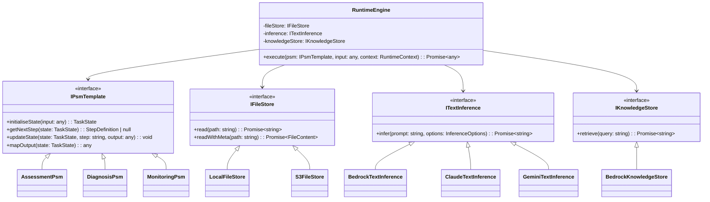
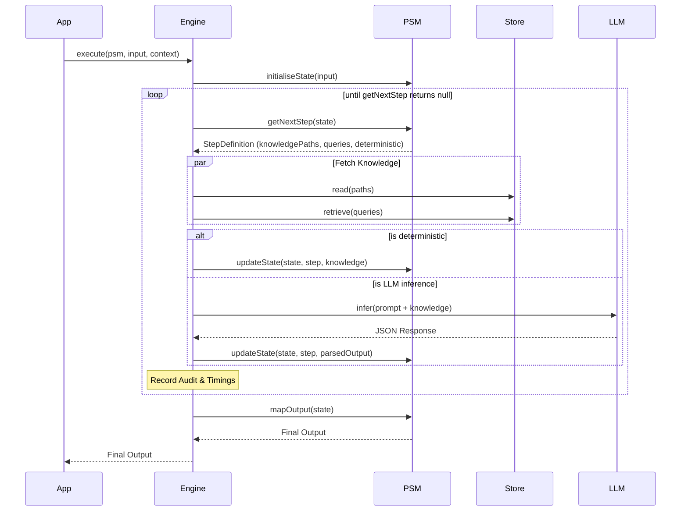

# Implementation Design - Knowledge Engine Runtime

## 1. System Architecture

The Lumina Knowledge Engine is designed as a decoupled runtime that separates the execution logic (PSMs) from the domain knowledge (files) and the underlying infrastructure (storage/LLM).

### 1.1 Class Diagram



---

## 2. Core Components

### 2.1 Task Execution Loop (RuntimeEngine)

The engine implements the core loop described in REQ-2.



### 2.2 RuntimeContext & State Management

- **TaskState**: A mutable object holding the current state of a task execution.
- **RuntimeContext**: Holds infrastructure components (logger), configuration (explain: boolean), and collects execution metadata (auditLog, timings, explanations).

---

## 3. PSM Implementations

### 3.1 Assessment PSM (REQ-3)
Implements the sequence: `obtain` -> `specify` -> `abstract` -> `evaluate` -> `conclude`.
- Maps output to `AssessmentResult`.
- Per-step override hooks: `updateObtain`, `updateSpecify`, `updateAbstract`, `updateEvaluate`, `buildResult` (conclude).

### 3.2 Diagnosis PSM (REQ-4)
Implements: `observe` -> `hypothesise` -> `verify` -> `conclude`.
- Focuses on fault detection and hypothesis verification.
- Per-step override hooks: `updateObserve`, `updateHypothesise`, `updateVerify`, `buildResult` (conclude).

### 3.3 Monitoring PSM (REQ-5)
Implements: `observe` -> `compare` -> `evaluate` -> `conclude`.
- Detects deviations between observed states and expected norms.
- Per-step override hooks: `updateObserve`, `updateCompare`, `updateEvaluate`, `buildResult` (conclude).

### 3.4 Per-Step Override Hooks (REQ-3/4/5)
Every step's "turn the engine's output into state" decision is an
independently overridable `protected updateX(output, state)` method (named
after the step; `conclude` keeps the existing name `buildResult`) - the
template's own logic is just the default implementation. `applyStep` is a
thin dispatcher that calls the matching hook and assigns its return value
into state; it has no logic of its own. A domain subclass overrides exactly
the hook it needs (e.g. `VitalSignsAssessmentPsm` overrides `updateSpecify`
and `buildResult`) without touching step sequencing, prompt construction, or
any other hook.

This does **not** let a hook call the inference capability itself:
`IPsmTemplate.updateState` is synchronous (`void`), and a PSM holds no
reference to `ITextInference` - only `RuntimeEngine` does. A hook can apply
arbitrarily complex synchronous logic to the output it's given; triggering
another LLM call from inside one would need a separate change (async
`updateState`, and an injected inference capability) - out of scope for now.

---

## 4. Storage & Providers

### 4.1 File Stores
- **LocalFileStore**: Uses Node.js `fs/promises`. Computes SHA-256 for versioning.
- **S3FileStore**: Uses `@aws-sdk/client-s3`. Uses `VersionId` from S3.

### 4.2 Knowledge Store
- **BedrockKnowledgeStore**: Uses `@aws-sdk/client-bedrock-agent-runtime`. Formats retrieved chunks into a single text block.

### 4.3 Inference Providers
- **BedrockTextInference**: Uses `@aws-sdk/client-bedrock-runtime` (Converse API). Supports system prompts, a named-guardrail factory (`withGuardrailName`), and optional JSON wrapping for the `explain` feature.
- **ClaudeTextInference**: Uses `@anthropic-ai/sdk`. Adaptive thinking on by default (REQ-16); falls back to the SDK's own credential resolution when no API key is supplied.
- **GeminiTextInference**: Uses `@google/genai`. Automatic `thinkingConfig.thinkingBudget` by default (REQ-17); falls back to the SDK's own credential resolution (`GOOGLE_API_KEY`/`GEMINI_API_KEY`) when no API key is supplied.

All three implement `ITextInference` identically from the engine's perspective - the CLI's `--provider` flag (REQ-15) is the only thing that picks between them; `RuntimeEngine` and the PSM templates never branch on provider.

### 4.4 Diagnostics Logging (REQ-18)
Distinct from the engine execution logger (§6.2/REQ-10), `src/utils/diagnostics.ts` exports `createDiagnosticsLogger(namespace)` for general application-code logging (CLI, providers, wiring). It returns the same `ILogger` shape, backed by either `debug` or `pino` depending on `STRATA_LOG_PROVIDER` (default `pino`) - call sites depend only on `ILogger`, never on the concrete library, so the provider can change (or a third one can be added) by editing `diagnostics.ts` alone. `pino`'s level is controlled by `STRATA_LOG_LEVEL`; `debug` has no native levels, so the level is folded into the message and visibility is controlled by the namespace via the standard `DEBUG` env var.

---

## 5. File Structure

```text
src/
├── core/
│   ├── engine.ts           # RuntimeEngine implementation
│   ├── context.ts          # RuntimeContext class
│   ├── interfaces.ts       # IFileStore, ITextInference, etc.
│   ├── types.ts            # AuditLogEntry, StepTiming, StepDefinition
│   ├── errors.ts           # FileNotFoundError, InvalidStoreConfigError, TaskExecutionError
│   └── index.ts            # barrel
├── psms/
│   ├── base-psm.ts         # Shared step-sequencing logic
│   ├── assessment-psm.ts   # Assessment PSM logic
│   ├── diagnosis-psm.ts    # Diagnosis PSM logic
│   ├── monitoring-psm.ts   # Monitoring PSM logic
│   └── index.ts            # barrel
├── providers/
│   ├── file/
│   │   ├── local.ts        # LocalFileStore
│   │   ├── s3.ts           # S3FileStore
│   │   └── index.ts        # barrel
│   ├── knowledge/
│   │   ├── bedrock-kb.ts   # BedrockKnowledgeStore
│   │   └── index.ts        # barrel
│   ├── inference/
│   │   ├── bedrock.ts      # BedrockTextInference
│   │   ├── claude.ts       # ClaudeTextInference
│   │   ├── gemini.ts       # GeminiTextInference
│   │   └── index.ts        # barrel
│   └── index.ts            # barrel (aggregates file/knowledge/inference)
├── domains/
│   ├── vital-signs/
│   │   ├── types.ts                     # VitalSignsInput, VitalSignsNorm
│   │   ├── vital-signs-assessment-psm.ts # VitalSignsAssessmentPsm
│   │   ├── wiring.ts                     # createVitalSignsAssessment()
│   │   └── index.ts                      # barrel
│   └── index.ts            # barrel
├── utils/
│   ├── logger.ts           # StreamLogger, LevelFilterLogger (engine execution logger)
│   ├── diagnostics.ts      # createDiagnosticsLogger (general app logging, REQ-18)
│   ├── llm-helpers.ts      # Regex/parsing for LLM outputs
│   └── index.ts            # barrel
├── cli/
│   ├── index.ts            # commander-based CLI entry point (bin)
│   └── vital-signs-assessment.ts  # domain-specific CLI command + --provider dispatch
└── index.ts                 # package root barrel (re-exports every directory barrel)

bin/
└── vital-signs-assessment.sh  # wraps dist/cli/index.js with a default payload

knowledge/
├── ontology/health-domain.yml
└── health/vital-signs-assessment/{norms.yml,abstraction.md,selection.md,evaluation.md}
```

Barrel convention: every directory with more than one file gets an `index.ts`
re-exporting its siblings, and **cross-directory** imports always go through
the target directory's barrel. A file never imports its own directory's
barrel for a sibling (that would be a self-referential/circular import) -
same-directory sibling imports stay direct. `src/cli/` is the one exception:
`index.ts` there is the actual bin executable (shebang, side-effecting
top-level `await`), not a re-export module, so it isn't turned into a barrel.

---

## 6. Logic Details

### 6.1 Explanation Wrapper (REQ-11)
When `context.explain` is true:
1. The engine adds `_explain: true` to the prompt context.
2. The PSM templates are instructed to request a response in the format:
   ```json
   {
     "result": { ... },
     "_explanation": "Plain English reasoning..."
   }
   ```
3. The engine unwraps this, saves `_explanation` to `context.explanations`, and passes `result` to the PSM's `updateState`.

### 6.2 Audit & Timings (REQ-12)
Each step in the loop will trigger:
- `context.auditLog.push({ step, knowledgeRefs, deterministic })`
- `context.timings.push({ step, startedAt, durationMs })`
